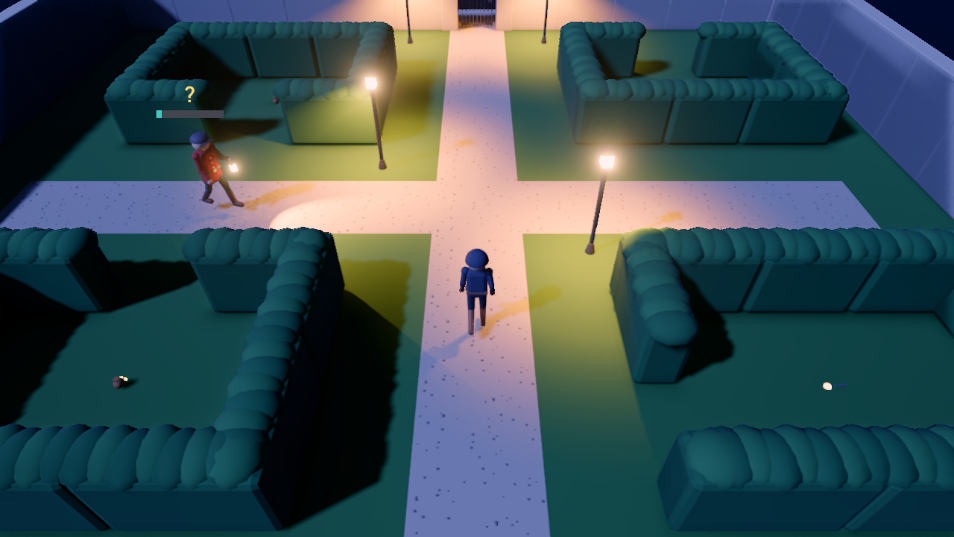
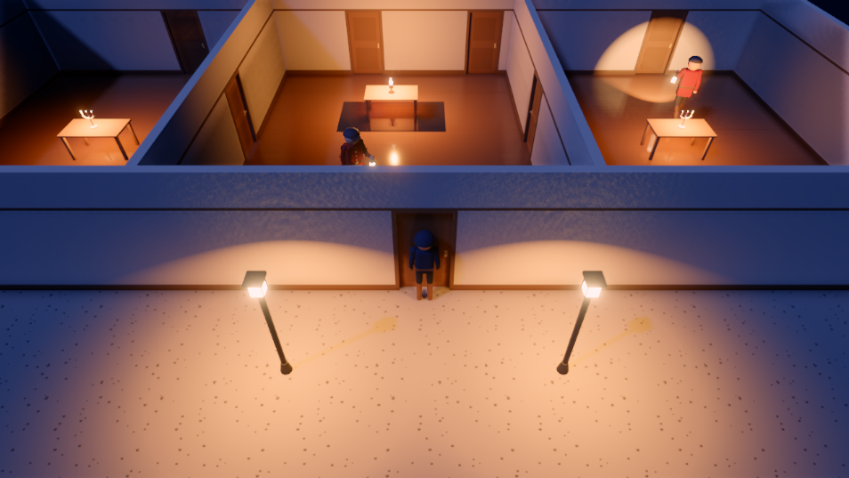
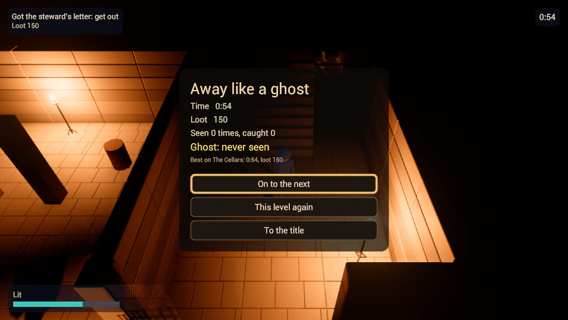

# Lamplight

A night-time manor heist in pure stealth, built through the engine's MCP tools, using dynamic
lights and shadows, navigation, animation graphs, physical surfaces, reverb, auto exposure and the
engine's GUI. It is Raptor's Lamplight, ported: the same levels, models, sounds and rules, its
scripts in this engine's AngelScript API.

## The game

Slip into the manor at night and take the one thing each level is about, then get out. Light is
what gives you away: the light meter reads the lamps and lanterns around you, and a guard sees you
by his lantern's cone, sooner the brighter you stand. Guards walk their rounds on the navigation
mesh, hear your footsteps on each surface (gravel louder than boards, grass softer, and a run
louder than a walk), and come to look where a thrown pebble lands. Put lamps out, pick the locks on
doors and gates, keep to the dark, and sneak when a guard is near; walls between the camera and the
thief fade out of the way.

Five levels, each opened by the one before it:
- **The Gardens**: hedges, lantern posts and a garden wall, for the gardener's key.
- **The Stable Yard**: in the rain, round hay bales and the stable's stalls, for the stable ledger.
- **The Ground Floor**: the manor's rooms by lamplight, for the butler's keys.
- **The Cellars**: torch-lit passages under the house, for the steward's letter.
- **The Upper Floor**: bedrooms, the master's study and a vault behind a strong door, for the
  family jewels.

Purses and candlesticks along the way are loot, counted in the results. A guard who sees you gives
chase; one who catches you sends you back to your last checkpoint, and the level goes on. On the
upper floor a chase rings the alarm bell, loud enough for every guard on the floor to come.
Escaping with the target ends the level with its results: the time, the loot, how often you were
seen and caught, and a ghost medal for a level no guard ever chased you through. The best time, the
most loot and the ghost medal are saved for each level.

Controls: W A S D (or the left stick) to move, relative to the camera; C (B) to sneak, slow and
silent; Left Shift (pressing the left stick) to run, fast and loud; F (A) to use: open a door, put
out a lamp, or hold to pick a lock; G (X) to throw a pebble; Q and E (the shoulders) to turn the
view a quarter; Escape (Start) to pause. The controls show for a few seconds as each level starts.
On a touch screen: a stick anywhere on the left half to move, and buttons on the right to use,
throw, sneak, run and turn; a small pause button under the top-left of the HUD. They show once the
screen is touched.

## Project layout

- `Project.xml`: the manifest: the first level (`Scenes/Gardens`), the Game script
  (`Scripts/Lamplight`), the input map and the GUI sheet.
- `Sources/`: the raw sources the assets import from: the AngelScript scripts, the GUI markup and
  its sheet, the Blender models and the generated sounds.
- `Content/`: the asset envelopes (`*.xasset`) and their sidecars: the five level scenes (and a
  test room) with their navigation, the thief and the guards with their skeletons, clips and
  animation graphs, the manor and grounds kits, the loot, the materials and surfaces, the rain,
  the sounds, the night environment and post profiles, and the screens.
- `Tools/`: the authoring scripts that build the game through the editor's MCP tools: the models,
  the input map, the look, the sounds, the scripts and the levels. Not game content;
  `Tools/README.md` says what each does, in order.
- `export_presets.xml`: the export targets (Linux and Windows desktop, web, Steam Deck).
- `CREDITS.md` and `Licenses/`: the font.
- `Cooked/`, `.cache/`, `Editor/`, `Dist/`: generated, and gitignored; the tools rebuild them.

Every model is built by `Tools/`' Blender scripts (Raptor's, in `Tools/blender/`) and every sound
is generated by its scripts; the UI font is Roboto (Apache 2.0), credited in `CREDITS.md` with its
notice in `Licenses/`.

The port's one engine gap: a noise is one event carrying its place and its loudness, a `Float4`,
which script events here could not carry until this port added it.

Open the project from the editor's project manager.
