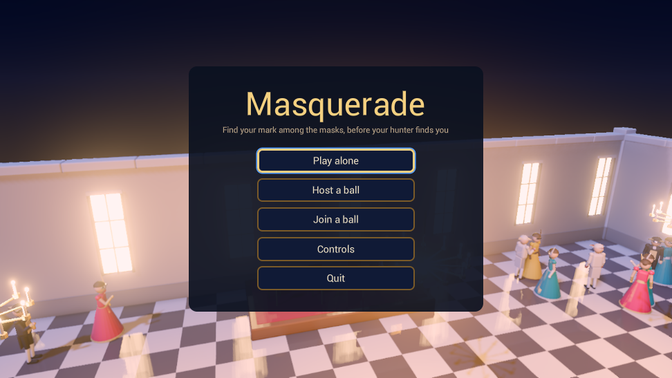
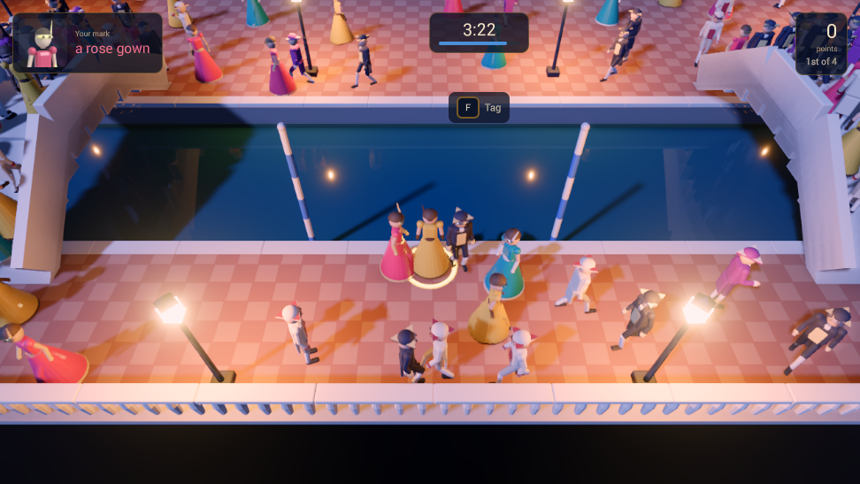
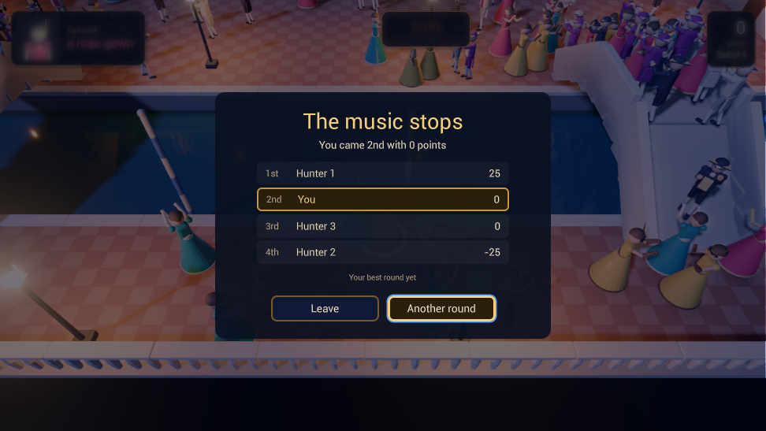

# Masquerade

Social stealth at a masked ball, alone against bots or with up to four players over the network,
built through the engine's MCP tools, using the network stack, crowds on navigation, instanced
skinned meshes, custom shaders and the engine's GUI. It is Raptor's Masquerade, ported: the same
maps, models, sounds and rules, its scripts ported to the game's own Beef code.

## The game

Some 150 guests in masks wander a palace at night: they stroll, gather in groups to talk, and
dance when the orchestra plays. Four of them are hunters, and you are one. Each hunter is given a
mark, another hunter, shown on the HUD by the costume it wears; six costumes are shared by every
guest, so the portrait narrows the search rather than ending it. Find your mark and tag it before
your own hunter finds you.

Move like a guest and you are hard to find. Sprint, and you show on your hunter's screen for a
moment; stand still while everyone dances, and you stand out. Tagging your mark scores 100 points,
and it comes back elsewhere in a new costume; tag anyone else and you lose 25, and your mask flares,
showing you to everyone for a few seconds. A word tells you when your hunter is near. A round
lasts four minutes, and the most points wins.

Three maps, each a different shape for the crowd:
- **The Palace**: a courtyard with a fountain and lanterns, and a ballroom where the dancing is.
- **The Canal**: a square at carnival, quays and bridges that squeeze the crowd into lines, and
  gondolas passing under.
- **The Gardens**: a hedge maze round a fountain, and the orchestra's orangery.

Play alone and the other three hunters are bots that play by the same rules. Host a ball and the
others join it (on port 7777) by its address; a joiner takes the host's map, and the host runs the
world for everyone. The best round on each map is saved.

Controls: WASD (or the left stick) to move, relative to the camera; Left Shift (or pressing the
stick) to sprint; F (or A, cross) to tag the guest in front of you; Space (or B, circle) held to
dance; Q and E (or the shoulders) to turn the camera a quarter; Escape (or Start) to pause. The
Controls page shows them as the device in hand draws them. On a touch screen: a stick on the left
half, and buttons on the right to tag, dance, sprint and turn.

## Project layout

- `Project.xml`: the manifest: the start scene, the input map, the GUI sheet, and the game's own
  package (`Code`).
- `Code/`: the game's own code, a Beef package the project builds into its own editor and player
  (below).
- `Sources/`: the raw sources the assets import from: the GUI markup and its sheet, the Blender
  models, the shaders, the pictures and the generated music and sounds.
- `Content/`: the asset envelopes (`*.xasset`) and their sidecars: the three maps and their
  navigation, the prefabs, the guests' models with their clips, the materials and shaders, the
  environment and post profiles, the audio and the GUI.
- `Tools/`: the authoring scripts that build the game through the editor's MCP tools: the models,
  the shaders, the input map, the look, the sounds, the pictures, the screens, the maps, and the
  move from scripts to the game's code. Not game content; `Tools/README.md` says what each does
  and in which order.
- `export_presets.xml`: the export targets (Linux and Windows desktop, web, Steam Deck).
- `CREDITS.md` and `Licenses/`: the sky and the font.
- `Cooked/`, `.cache/`, `Editor/`, `Dist/`: generated, and gitignored; the tools rebuild them.

The models are Raptor's, built by its Blender scripts, and the music, the sounds, the button
glyphs and the costumes' portraits are generated by `Tools/`. The sky is Poly Haven's (CC0) and the UI font is
Roboto (Apache 2.0), credited in `CREDITS.md`.

## Its code

The game is Beef, the project's own code in `Code/Masquerade/src`: `MasqueradeGame` is the run (the
title, hosting and joining, the HUD, the pause menu, the results and the best round in the save),
and the behaviours on the entities are the guests and the bots (`Guest`), the player's hunter
(`Player`), the camera (`CameraRig`), the round (`Ball`: the hunters' costumes and targets, tags,
flares, the bots' hunting and the scores) and the orchestra's cues and music (`Orchestra`). Over the
network the host runs the world: the guests' and hunters' activities, the cue and the round's state
are replicated fields, a client's input and tags reach the host as messages, and the round reports
to the game through the run's events (`Events.bf`). The project builds it into its own editor and
player (Project > Build Project); the stock editor does not run it, so open the project in the
editor its build makes (Project > Open With This Build).

Open the project from the editor's project manager.
