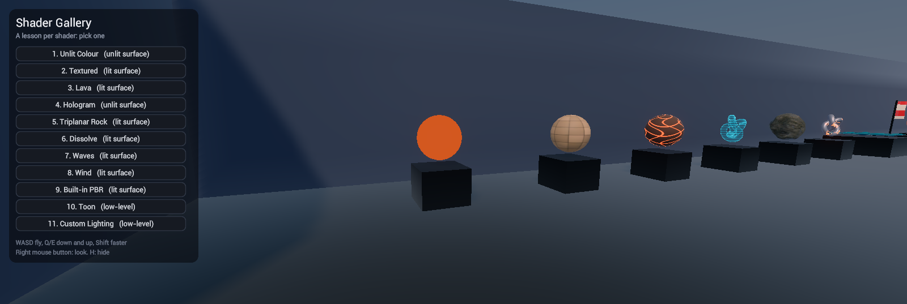
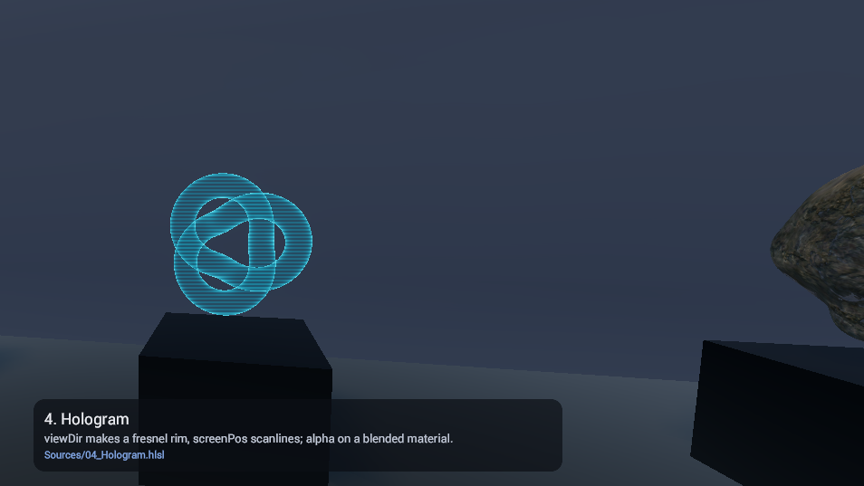
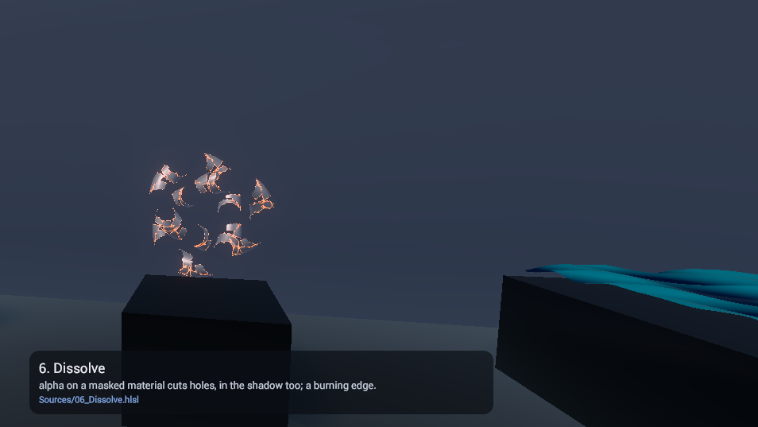
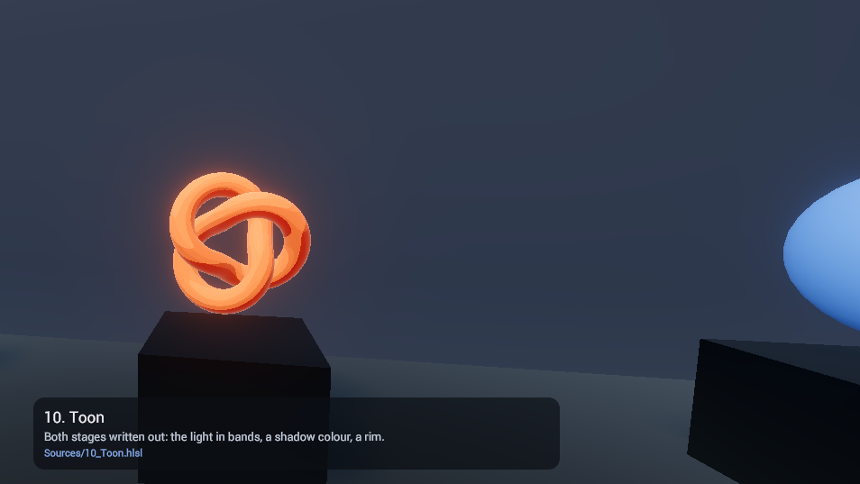

# Shader Gallery

The custom shaders sample: a hall of lesson shaders to fly through, each on its own plinth, each
`.hlsl` a short commented lesson that builds on the one before. Surface shaders first (the kind to
start with), then the low-level kind. It is Raptor's Shader Gallery, ported: the same lessons,
exhibits and hall, its camera's script in this engine's AngelScript API.

## Walking it

- Fly with WASD (or the left stick), Q and E (or the shoulders) to sink and rise, Shift (or press
  the stick) to go faster.
- Look with the mouse while its right button is held, or with the right stick.
- Click a lesson in the list to glide to it; what it teaches and its file show in a caption at
  the foot of the view. H (or Y) hides the list and the caption.

## The lessons

| # | Shader | Kind | What it teaches |
|---|---|---|---|
| 1 | Unlit Colour | unlit surface | The smallest shader: a properties block and `Surface()` |
| 2 | Textured | lit surface | Sampling a texture; uv; the vertex colour; lighting |
| 3 | Lava | lit surface | `Time()`, scrolling, emission |
| 4 | Hologram | unlit surface | `viewDir` and a fresnel rim; `screenPos` scanlines; alpha on a blended material |
| 5 | Triplanar Rock | lit surface | Mapping by `worldPos`, no uv; a normal map into tangent space |
| 6 | Dissolve | lit surface | `alpha` on a masked material, the shadow cut too; a glowing edge |
| 7 | Waves | lit surface | `Vertex()`: displacement, the normal from the slope, the shadow following |
| 8 | Wind | lit surface | `Vertex()` with `localPosition`: the hoist still, the fly end flapping |
| 9 | Built-in PBR | lit surface | The engine's own material, written as a surface: the reference |
| 10 | Toon | low-level | Lighting of its own: bands, a shadow colour, a rim |
| 11 | Custom Lighting | low-level | Walking the lights itself (`LightsAt`, `LightAt`, `ShadowOf`): half-Lambert, Blinn-Phong |

Read them in `Sources/` (the shader page opens them in the editor), in order. Each material is
part of its lesson: open it on the material page and drag its sliders.

## How it is built

Through the editor's MCP tools, by the scripts in `Tools/` (their README says the order): the
lessons table (`lessons.py`) drives the shaders and their materials (`shaders.py`), the hall
(`hall.py`) and the list and the camera's script (`ui.py`); the exhibits that are not primitives
(the knot, the rock, the water, the flag) are modelled in Blender from code (`blender/exhibits.py`).
The lesson shaders are Raptor's unchanged: both engines compile the same surface and low-level
shaders.
