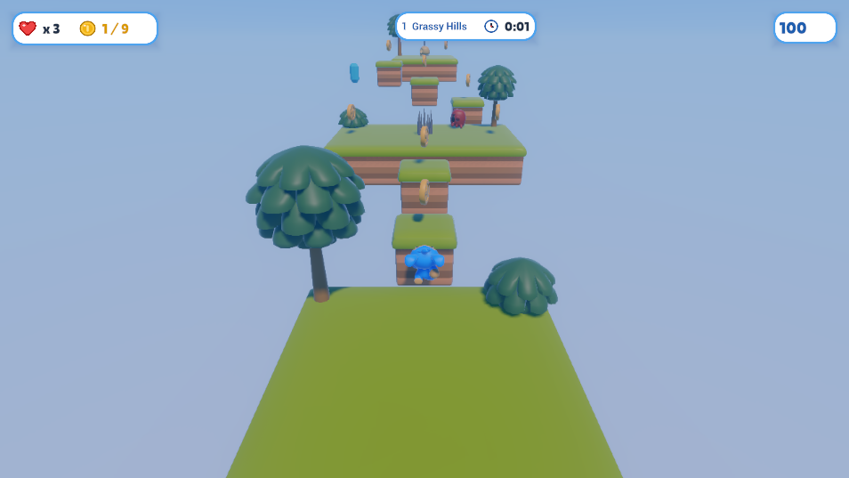

# Sky Hopper

A small 3D platformer, built entirely through the engine's MCP tools: the test of how far an
agent gets making a game with them, where every missing or wrong tool was fixed in the engine
as part of the work. It has also shipped to a Steam Deck through the container build
(`Code/Tools/SteamDeck/`).

## The game

Five levels of floating islands (Grassy Hills, Crab Crossing, Sky Climb, Bee Meadow, Cloud
Fortress): hop between platforms, collect coins, stomp crabs, skulls and bees from above, cross
bridges, dodge spikes, swinging saws and spiky balls, and reach the flag.
A title screen with settings (master, music and effect volumes), an intro banner per level, a
pause menu, a HUD of icons (lives, coins, the gem, the clock and the score, with gains floating
up from it), the clear card, a game over card and a victory screen with the run's totals.
Falling respawns you on the last safe ground.

A run has three lives: a fall or a hit costs one, a heart found in a level gives one back, and
so does every 50th coin; the last one lost is the game over, and trying again starts from the
first level. Coins, stomps and each level's hidden gem score points, and a clear adds a bonus
for every second under the level's par time and for a level without a fall. Each clear earns up
to three stars (all the coins, no falls, under par), counted up on the clear card; the best
score, stars and time of every level, and the best run, are saved and shown on the title.

Controls: WASD to move, Space to jump, Escape to pause; the arrows and Enter drive the menus. A
gamepad works throughout: the left stick to move (and the stick or d-pad in menus), A (cross)
to jump and confirm, Start (Options) to pause. On a touch screen: a stick anywhere on the left half
to move, a button in the bottom-right corner to jump, a small one in the top-left to pause, and a
tap on the menus; they show once the screen is touched (`Tools/touch.py` binds them).

## Project layout

- `Project.xml`: the manifest: the start scene, the input map, the GUI's sheet and fonts, the
  render resolution (1280x720, letterboxed), and the game's own package (`Code`).
- `Code/`: the game's own code, a Beef package the project builds into its own editor and player
  (below).
- `Sources/`: the raw sources: the screens (`.xml`) and their sheet, the fonts, the audio, and the
  kit's glTF models.
- `Content/`: the asset envelopes (`*.xasset`) and their sidecars.
- `Tools/`: the authoring scripts that drive the editor's MCP tools (levels 4 and 5 among them);
  not game content.
- `export_presets.xml`: the Linux desktop, Steam Deck and Web export targets.
- `CREDITS.md` and `Licenses/`: the third-party assets and their licences. The music by CodeManu
  is CC-BY 3.0 and must stay credited; everything else is CC0, OFL or Apache 2.0.
- `Cooked/`, `.cache/`, `Editor/`, `Dist/`: generated, and gitignored; the tools rebuild them.

Open the project from the project manager.

## Its code

The game is Beef, the project's own code in `Code/SkyHopper/src`: `SkyHopperGame` is the run (the
title, the levels in order, the HUD, the lives and the score, the pause and clear cards, the saves
and the settings), and the behaviours on the levels' entities are the player
(`PlayerController`), the camera (`FollowCamera`), coins, pickups, enemies, hazards, movers, the
flag (`Goal`) and the effects' `TimedLife`, which report to the game through the run's events
(`Events.bf`). The project builds it into its own editor and player (Project > Build Project); the
stock editor does not run it, so open the project in the editor its build makes (Project > Open
With This Build).
