<h1>
  <picture>
    <source media="(prefers-color-scheme: dark)" srcset="Data/Branding/sedulous-logo.svg">
    
  </picture>
</h1>

[](https://discord.gg/WSvxW8mWH5)
[](LICENSE)
[](https://github.com/SedulousWorks/SedulousEngine/releases)

A game engine and editor written in [Beef](https://www.beeflang.org/). It provides a
complete game development ecosystem, combining an integrated editor, asset pipeline, runtime and
toolchain with advanced rendering, gameplay scripting and a CSS styled UI framework. Games made in
the editor export to a desktop player, to the browser (WebGPU through emscripten) and to the Steam
Deck. Its agentic workflow, through an MCP host, enables AI agents to build entire games, from
initial project setup to fully playable experiences.

This is the second iteration of the engine. The previous one continues on the `v0` branch;
[Documentation/Changes.md](Documentation/Changes.md) shows what changed between the two.

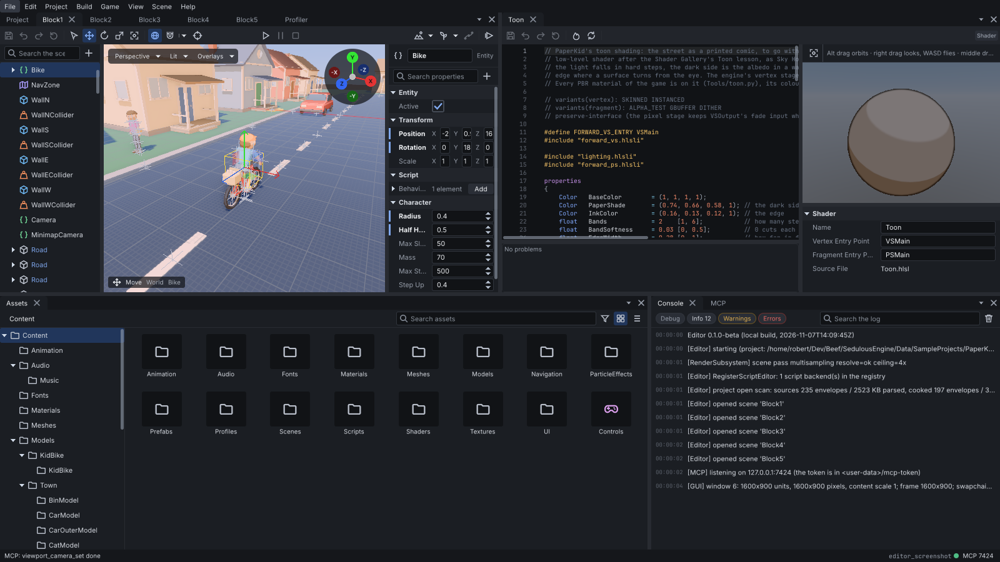

## Features

- **Written in Beef:** the runtime, the editor and the tools are one Beef workspace, over Beef
  bindings for the native libraries they use.
- **Rendering hardware interface (RHI)** with Vulkan 1.3, Direct3D 12 and WebGPU (desktop through
  wgpu-native, and the browser) backends.
- **Renderer:** a render graph driving forward PBR with a depth prepass and clustered lights;
  cascaded sun shadows and shadowed point and spot lights; image-based lighting and reflection
  probes; decals, sprites, particles, skinned and instanced meshes; render textures for in-game
  cameras.
- **Post-processing:** ambient occlusion, SSR, screen-space GI, bloom, TAA, MSAA, FXAA, auto
  exposure and colour grading. A game sets them in shared environment and post profiles.
- **Shaders:** HLSL compiled through DXC, cross-compiled to WGSL for the web, cooked into packs,
  and custom shaders per project.
- **Scene system:** entities with hierarchical transforms, component managers per domain,
  prefabs with overrides, and scene serialization.
- **Gameplay systems:** physics (Jolt), navigation (Recast/Detour), audio (miniaudio, four fixed
  buses plus custom ones with effect chains), input maps, save data, splines, terrain and
  vegetation.
- **Animation:** skeletal clips, animation graphs, IK, root motion and property animation.
- **Networking** with state replication.
- **Scripting** in AngelScript over a generated binding of the engine's `[Scriptable]` surface:
  behaviours per entity, a level script per scene and a game script per run, with coroutines,
  events and an in-editor debugger.
- **UI:** a retained-mode GUI with flex, grid and stack layouts, `.xml` markup, CSS sheets
  (cascade, variables, transitions, animations, media queries), shaped bidirectional text,
  keyboard and gamepad navigation, data binding, world-space UI, a game kit for screens and
  prompts, and an editor toolkit (docking, property grids, a code editor). Scripts can create and
  control any widget.
- **Vector graphics and fonts:** a vector graphics layer with SVG, and distance field and
  coverage fonts.
- **Editor** (`Sedulous.Tools.Editor`): project manager, scene hierarchy, viewport with gizmos and
  per-domain tools (terrain sculpting and painting, vegetation, splines), inspectors from
  reflection, an asset browser, undo and redo, play in editor (several instances side by side), a
  profiler, and a page per asset type.
- **Asset pipeline:** importers for glTF, FBX, OBJ, images, audio and fonts; cooks per asset
  type; BC7 and ASTC texture compression.
- **Export** to the desktop player, the web (WebAssembly with WebGPU) and the Steam Deck, from
  per-target presets and player templates. Headless tools can run all of it from the command
  line.
- **Agent tooling:** an MCP host (`Sedulous.Tools.Mcp`) exposes the engine's reflection, the
  script API and project operations (import, cook, scene validation, export, health checks). The
  editor serves the same tools over HTTP for its open project, plus its pages and play in editor,
  where an agent plays the game with scripted input and reads back probes and screenshots.
  [AGENTS.md](AGENTS.md) describes how an agent works on the engine itself.
- **Samples:** five sample games, a custom shaders gallery and a native plugin sample (below),
  and low-level Beef samples per engine area ([Code/Samples/README.md](Code/Samples/README.md)).

## Download

Releases and the sample games are on the
[releases page](https://github.com/SedulousWorks/SedulousEngine/releases). The editor's project
manager downloads the samples from the release of its own version.

## Building

See [Documentation/BUILDING.md](Documentation/BUILDING.md) for the requirements, the build
commands and how to run the editor.

## Sample projects

Game projects under `Data/SampleProjects/`, opened from the editor's project manager. Each was
built through the engine's MCP tools by an AI agent, its authoring scripts kept in its `Tools/`.
[SedulousDemos](https://sedulousworks.github.io/SedulousDemos/) plays the games and the Shader
Gallery in a browser, Masquerade not yet.

**Sky Hopper** (`SkyHopper`) is a small 3D platformer, also shipped to a Steam Deck: five
floating islands, coins, enemies and hazards, menus with volume settings, music and effects,
and gamepad support throughout.

| Title | Level 1 | Settings |
|:---:|:---:|:---:|
| 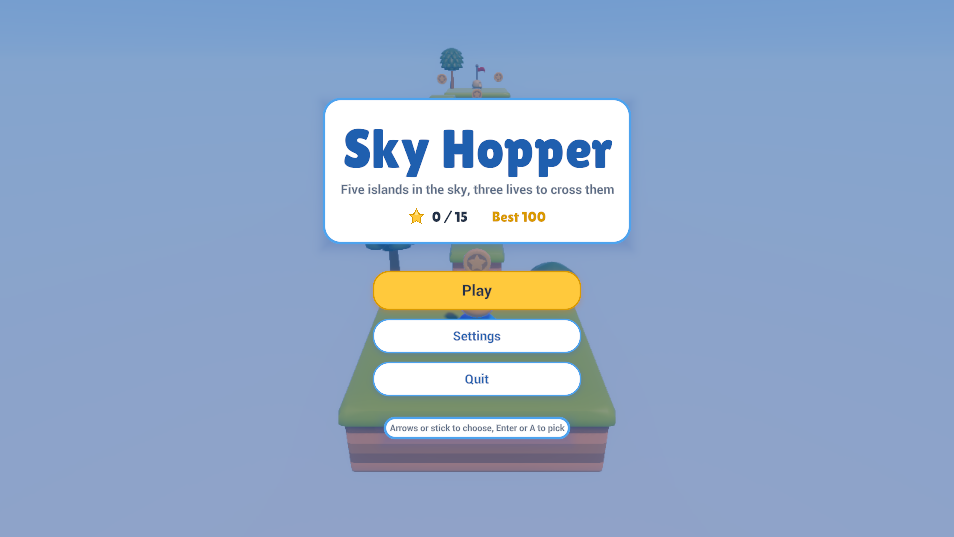 | 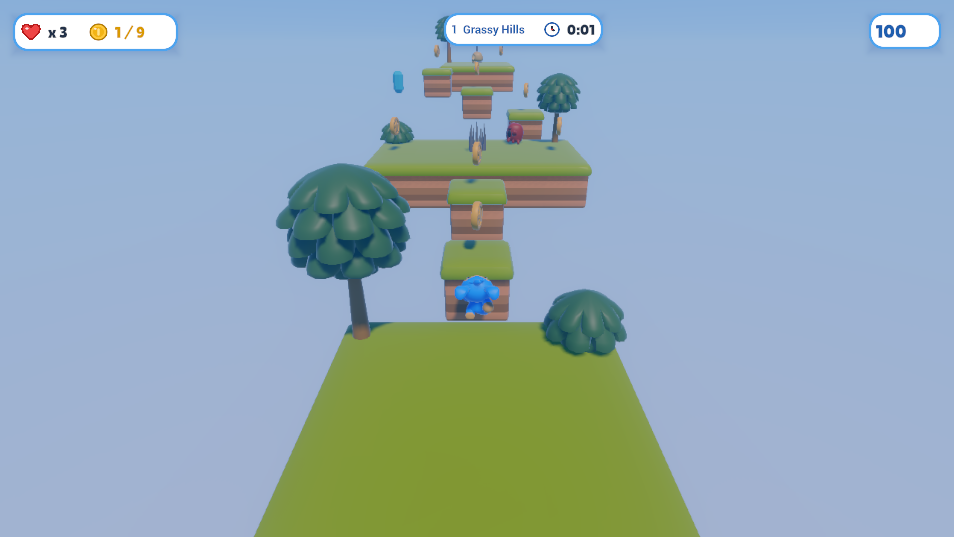 | 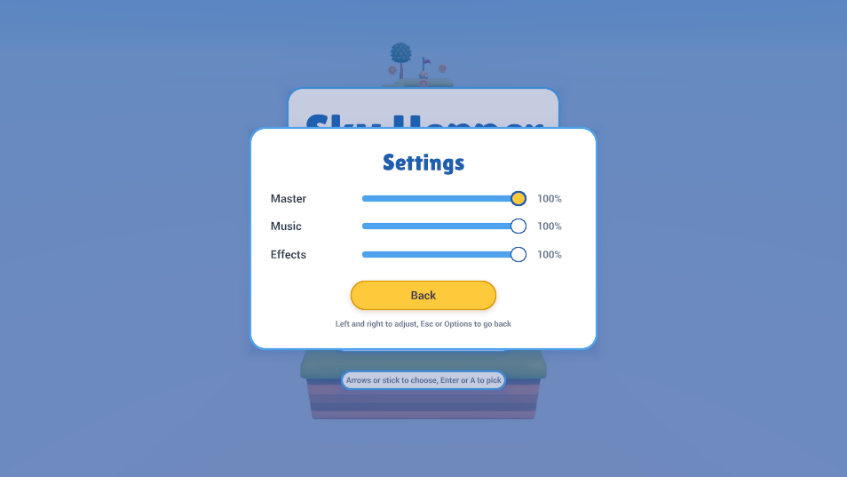 |

**PaperKid** is an arcade paper-route game: five town blocks on a difficulty ramp, papers thrown with a soft auto-aim, traffic and pedestrians on
the navmesh, lives, a live minimap drawn by a top-down camera into a render texture, particle
effects, a newsprint UI theme, and music that speeds up when the clock runs low. The kid and
his bike, the houses, cars, people and animals are modelled, rigged and animated by Blender
scripts.

| Title | Riding a block | Block cleared |
|:---:|:---:|:---:|
| 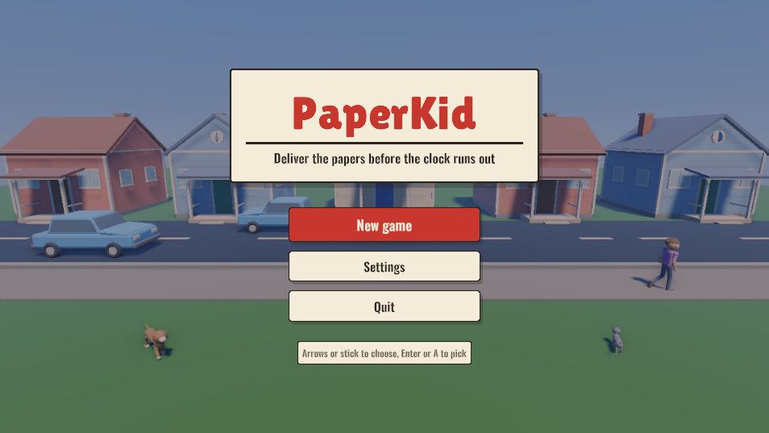 | 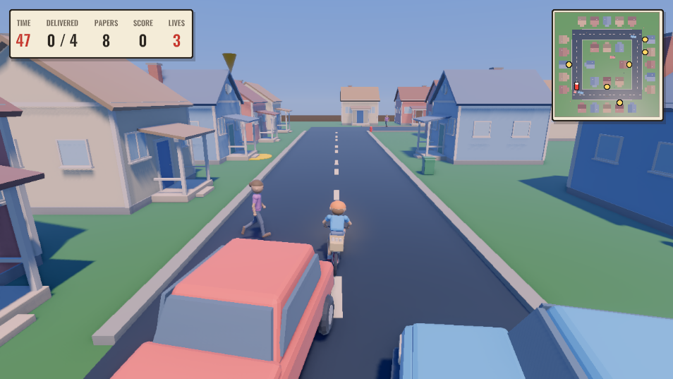 | 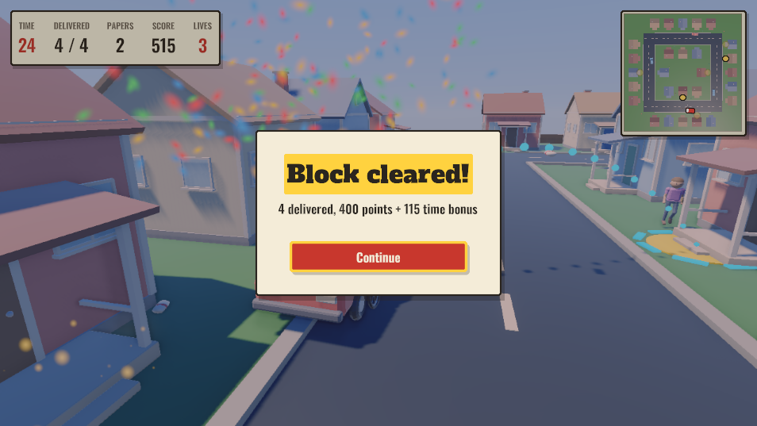 |

**Snowline** is a snowboard time trial with tricks: three courses on generated terrain with vegetation, slalom gates, gems and kickers, spins and
grabs scored into combos, medal ghosts and your own best run alongside, and an avalanche on the
last course. The rider is driven through an animation graph by parameters, and the board leaves
decal tracks in the snow. Its rider, trees and props are modelled by Blender scripts.

| Courses | Ridge, past the gap | A run's results |
|:---:|:---:|:---:|
| 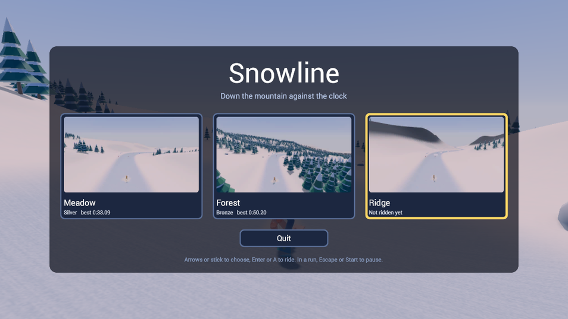 | 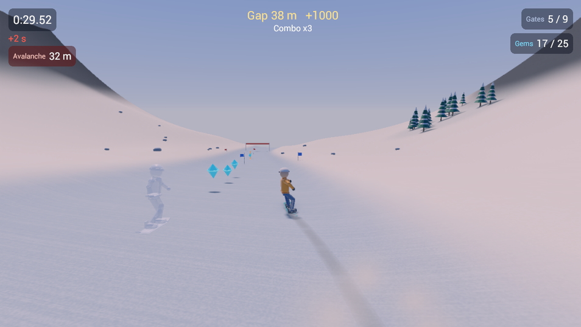 | 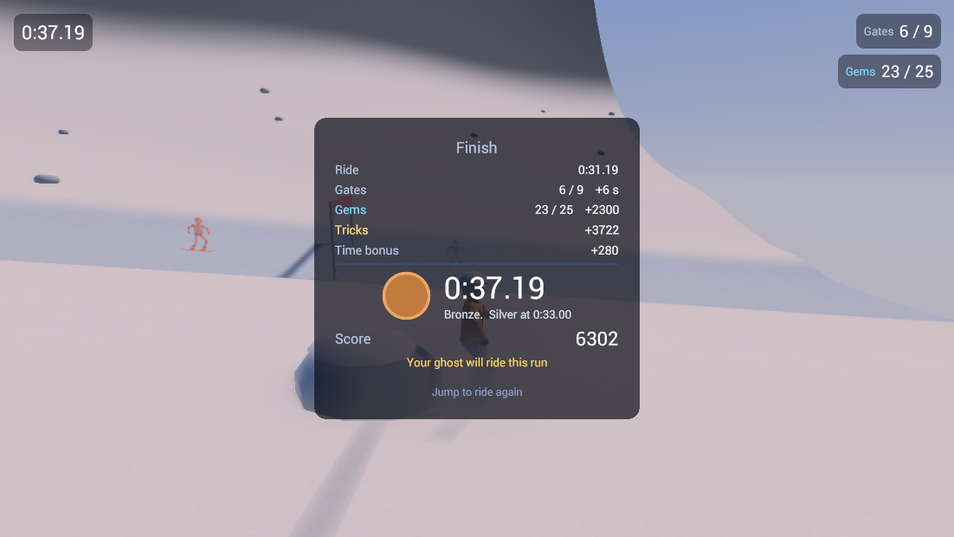 |

**Lamplight** is a night-time manor heist in pure stealth: lamplight and lantern shadows, a light
meter that reads the renderer's own lights (a guard's eye reads the same), guards on navigation
rounds who see by their lantern's cone, hear footsteps on each surface and come to a thrown
pebble, doors and gates to pick, walls that dither away between the camera and the thief, rain,
reverb per room, and auto exposure from moonlit grounds into torch-lit cellars. Five levels, from
the gardens to the vault on the upper floor.

| The Gardens | The Ground Floor | Away like a ghost |
|:---:|:---:|:---:|
| 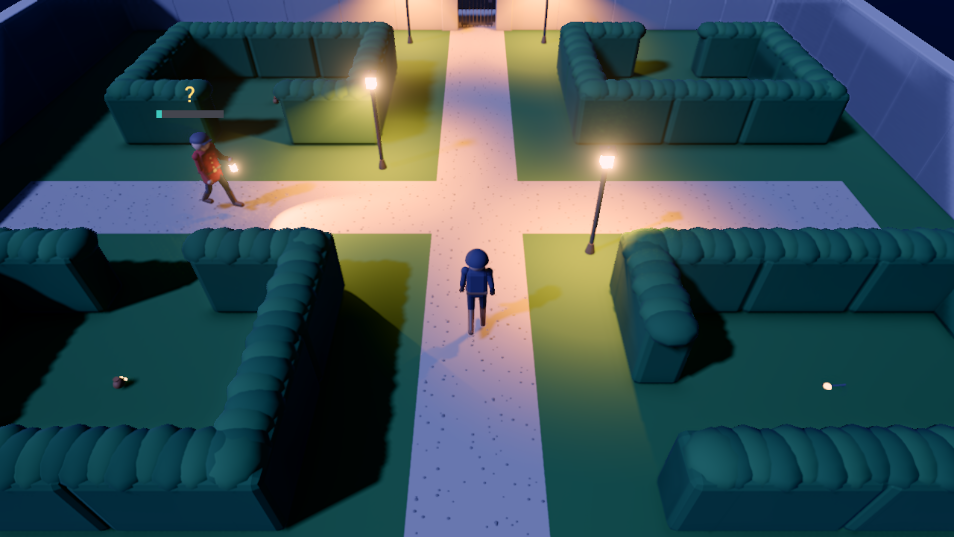 | 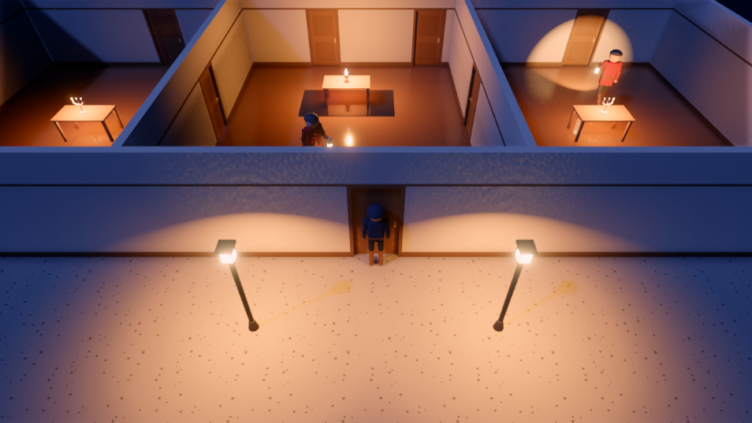 | 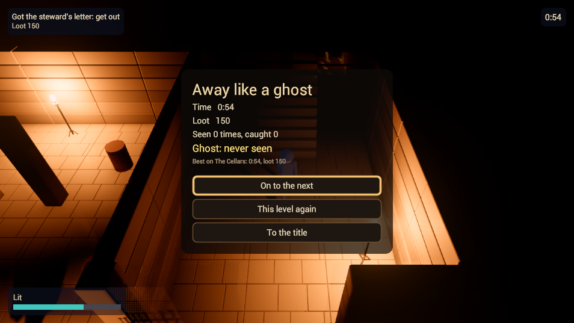 |

**Masquerade** is social stealth at a masked ball, alone against bots or with up to four players
over the network, chosen to show the network stack and crowds: an authoritative host that plays
and players joining it (natively, or from a browser through its gateway), replicated script state,
and some 150 guests on navigation drawn as instances of six costumes. Each hunter is given a mark, a guest in one of those costumes, and is
someone else's mark; guests stroll, gather and dance to the orchestra's cues, and a hunter who
sprints or stands still through a dance stands out. Three maps: the Palace, the Canal with its
gondolas, and the Gardens. Masks and silk on custom shaders, music the crowd follows, and the
models, the music and the sounds all made by its scripts. More in
[its README](Data/SampleProjects/Masquerade/README.md); it is not on SedulousDemos or the Deck yet.

| The title | On the Canal | The music stops |
|:---:|:---:|:---:|
| 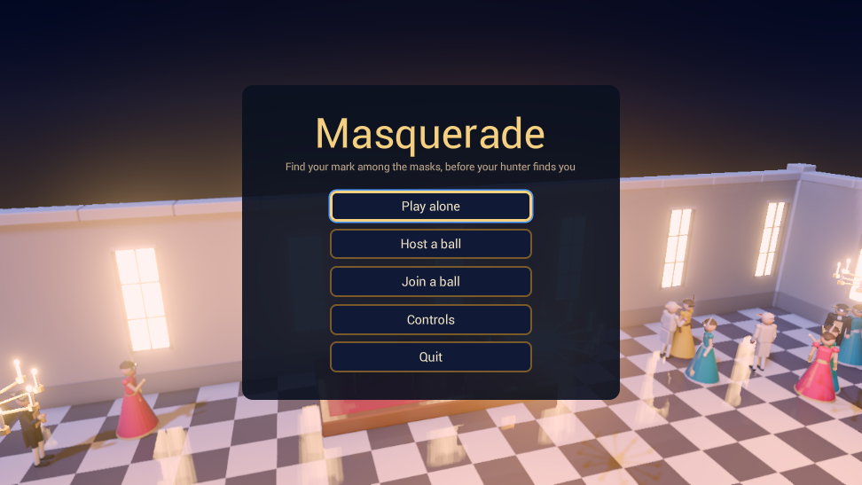 | 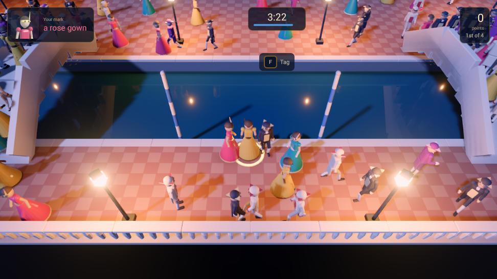 | 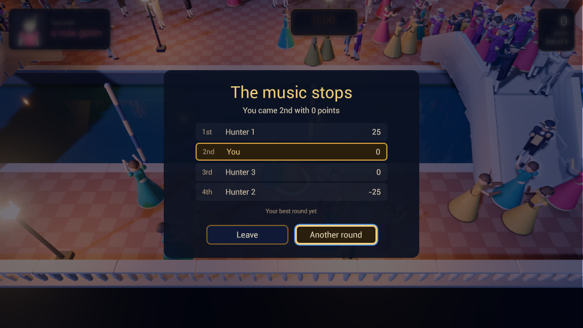 |

**The Shader Gallery** is the custom shaders sample: a hall of eleven lesson shaders to fly
through, each on its own plinth and each `.hlsl` a short commented lesson that builds on the one
before, surface shaders first (an unlit colour, textures, lava, a hologram, triplanar rock, a
dissolve, waves and a flag that move their vertices, the built-in PBR) and then two low-level ones
(a toon and lighting of its own). Pick a lesson in the list and the camera glides to it.

| The hall | Hologram | Toon |
|:---:|:---:|:---:|
| 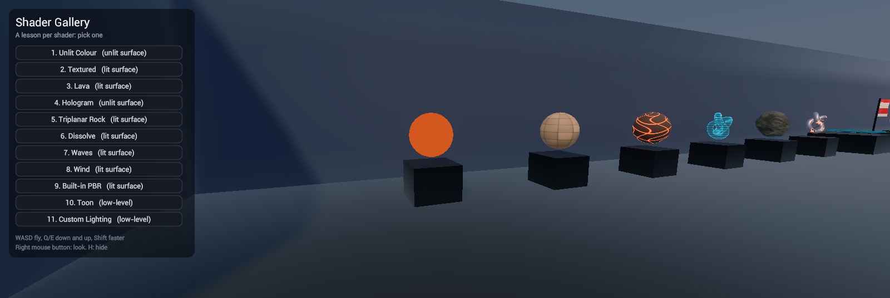 | 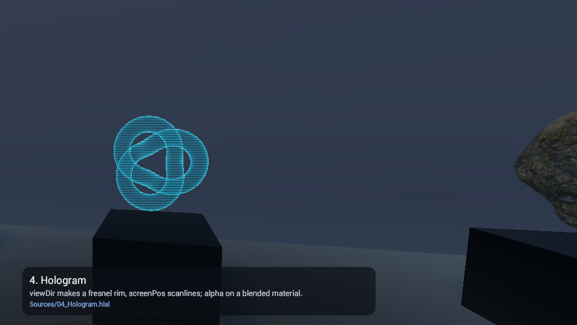 | 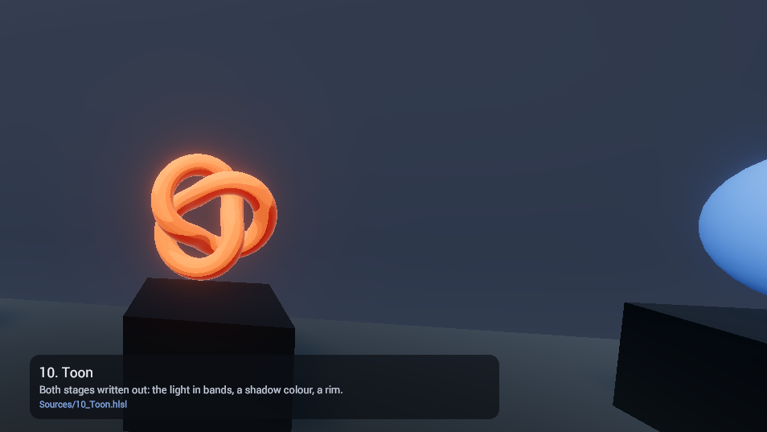 |

**NativeSample** is the reference for a game's own native Beef code: its `Code/` folder is the
project's Beef workspace, the game library with all four parts (runtime, pipeline, tooling and
editor), built into the project's own editor and player (Project > Build Project), and a scene of
cubes its native Spin component turns, one of them moved up and down by its Bob behaviour.

## Repository layout

```
Code/
  Foundation/     Core, RHI and backends, Shell, Resource, VFS, Scene, Render, GUI, VG,
                  Fonts, Audio, Physics, Navigation, Net, Script, Shaders, ...
  Engine/         The subsystems over Foundation, the default application, the player
  Pipeline/       Importers and cooks per asset type, the export
  Editor/         Editor core and one module per domain
  Tools/          Editor, Cook, Export, ShaderPack and Mcp executables; the Steam Deck build
  Samples/        Engine, web, UI and RHI samples (see Code/Samples/README.md)
  Integration/    Cross collection flow tests
Data/             Engine data (shaders, fonts, themes, environments) and the sample projects
Dependencies/     Beef bindings for the native libraries, with prebuilt binaries
Bin/              Naga and Tint, the WGSL tools the shader cook drives
Documentation/    Shipping documentation, served to agents through the MCP host
```

Each Foundation and Engine module has a sibling `.Tests` project; `Integration/` holds the
flows that cross collections.

## Platform support

- **Linux and Windows:** the development platforms, on Vulkan and D3D12; the editor and the
  player run on both. WebGPU also runs on the desktop through wgpu-native.
- **Web:** games export to the browser as WebAssembly with WebGPU.
- **Steam Deck:** games export through a Deck player template, built in a container by
  `Code/Tools/SteamDeck/build-steamdeck.sh`.
- **macOS:** no backend yet.

## Dependencies

Beef bindings, vendored under `Dependencies/`: Bulkan (Vulkan), Win32-Beef (D3D12 and
DXGI), wgpu-Beef, SDL3, Dxc-Beef, joltc-Beef, recastnavigation-Beef,
miniaudio (with stb_vorbis for Ogg), AngelScript-Beef, cgltf and ufbx, meshoptimizer,
msdfgen, stb_image and stb_truetype, HarfBuzz, SheenBidi, astcenc, bc7enc and bcdec, Mbed TLS,
zlib, cimgui. Each keeps its licence beside it, and those that ship in a binary are gathered into
`Dependencies/THIRD-PARTY-NOTICES.txt`, beside every player, editor and export.

## Community

Join the [Discord](https://discord.gg/WSvxW8mWH5) for discussion and support.

## Inspiration

Sedulous draws inspiration from [ezEngine](https://github.com/ezEngine/ezEngine),
[LumixEngine](https://github.com/nem0/LumixEngine) and [Traktor](https://github.com/apistol78/traktor).

## License

MIT. See [LICENSE](LICENSE). The SedulousEngine name and logo are not: they stay the project's
own, under the terms in [Data/Branding/LICENSE.txt](Data/Branding/LICENSE.txt).
